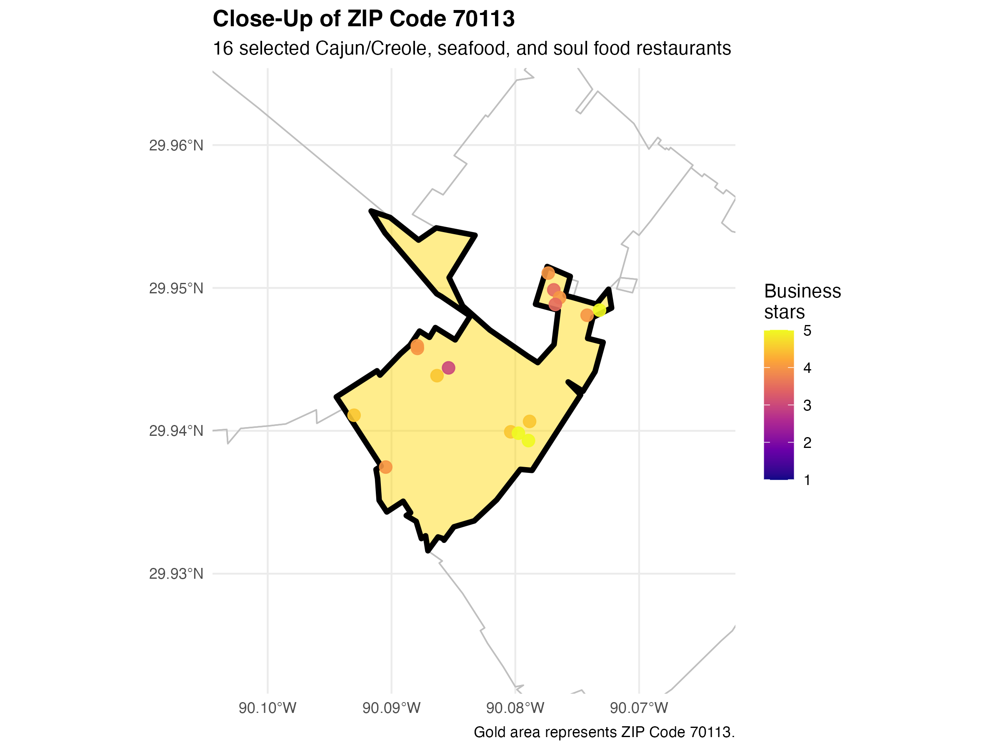
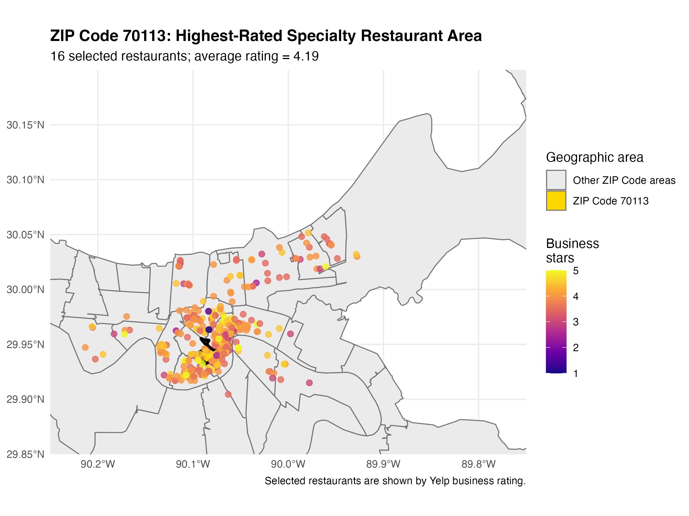

# yelp-new-orleans-project

## Selected geographic region

I selected ZIP Code 70113 as the main geographic region because it had the highest average Yelp rating among ZIP Code areas containing at least 10 selected restaurants. ZIP Code 70113 contained 16 Cajun/Creole, seafood, or soul food restaurants, with an average business rating of 4.19 stars and a median rating of 4 stars.

The CSV table shows the comparison of all ZIP Code areas with at least 10 selected restaurants. ZIP Code 70113 ranked first by average business rating. Requiring at least 10 restaurants makes the comparison more reliable than choosing a ZIP Code based on only one or two businesses.

### Top 10 ZIP Code Areas by Average Rating
This table includes the ten highest-rated ZIP Code areas, but some areas contain very few restaurants. Therefore, these averages may be less reliable. The main analysis uses ZIP Code areas with at least 10 restaurants.

|zcta  | number_of_restaurants| average_business_stars| median_business_stars|
|:-----|---------------------:|----------------------:|---------------------:|
|70129 |                     2|                   4.25|                  4.25|
|70113 |                    16|                   4.19|                  4.00|
|70117 |                    26|                   4.12|                  4.00|
|70125 |                     6|                   4.08|                  4.00|
|70122 |                    13|                   4.04|                  4.00|
|70001 |                     1|                   4.00|                  4.00|
|70114 |                     9|                   4.00|                  4.00|
|70121 |                     5|                   4.00|                  4.00|
|70123 |                     5|                   4.00|                  4.00|
|70131 |                     5|                   4.00|                  4.00|

### Top 10 ZIP Code areas

|zcta  | number_of_restaurants| average_business_stars| median_business_stars|
|:-----|---------------------:|----------------------:|---------------------:|
|70113 |                    16|                   4.19|                  4.00|
|70117 |                    26|                   4.12|                  4.00|
|70122 |                    13|                   4.04|                  4.00|
|70118 |                    27|                   3.96|                  4.00|
|70115 |                    56|                   3.92|                  4.00|
|70119 |                    53|                   3.90|                  4.00|
|70116 |                    76|                   3.84|                  4.00|
|70127 |                    12|                   3.79|                  4.00|
|70112 |                    62|                   3.73|                  3.50|
|70124 |                    16|                   3.69|                  3.75|

### Map of the selected region

The overview map shows where ZIP Code 70113 is located within New Orleans. Because the selected ZIP Code is relatively small, I also created a close-up map. The close-up makes the selected boundary and the 16 restaurants easier to see.

## Step 6: Geographic comparison

### Selected geographic system

I selected ZIP Code Tabulation Areas (ZCTAs) as the main geographic system and compared them with Census tracts.

I selected ZCTAs because all 607 selected restaurants were assigned to a ZCTA, while 13 restaurants were unmatched using Census tracts. ZCTAs also produced fewer and larger areas, making them easier to understand and visualize. Census tracts provided more detail, but their smaller boundaries created a more complicated map and included areas with very few restaurants.

### Geographic comparison table

| Geographic system | Number of areas | Restaurants assigned | Unmatched restaurants | Smallest area count | Largest area count |
|---|---:|---:|---:|---:|---:|
| ZIP/ZCTA | 22 | 607 | 0 | 1 | 194 |
| Census tract | 108 | 594 | 13 | 1 | 102 |

### ZIP Code map

### Census tract map

