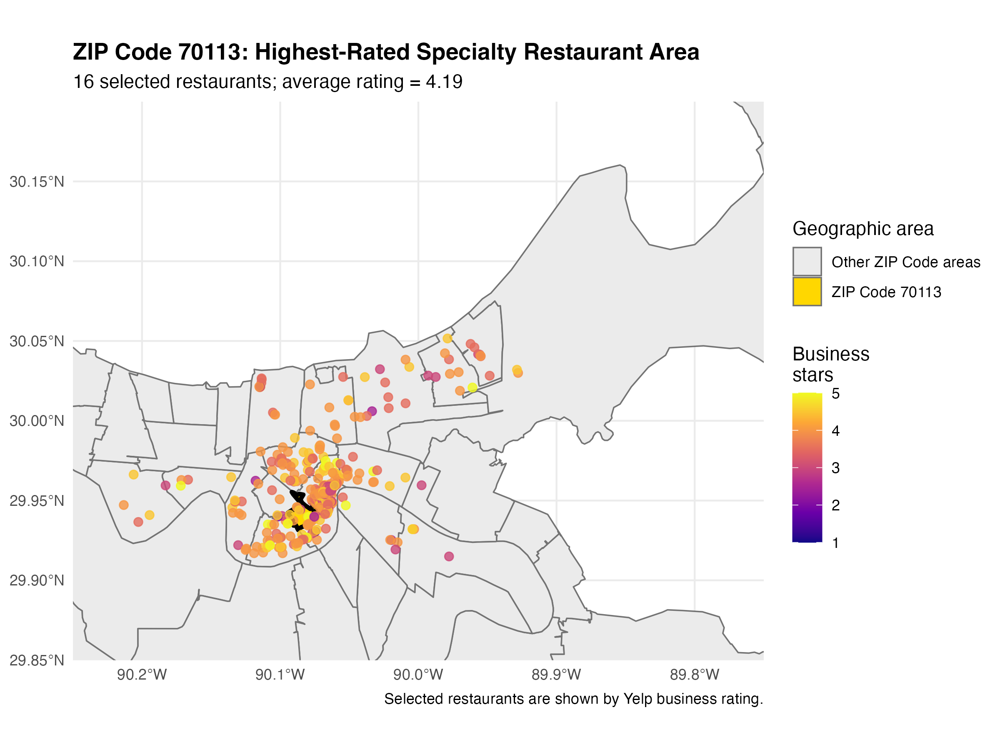
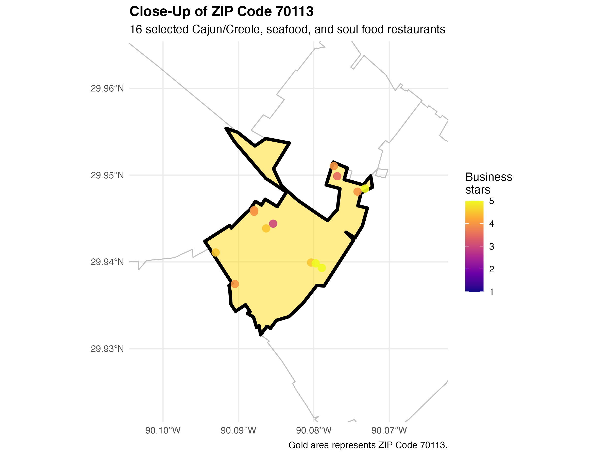
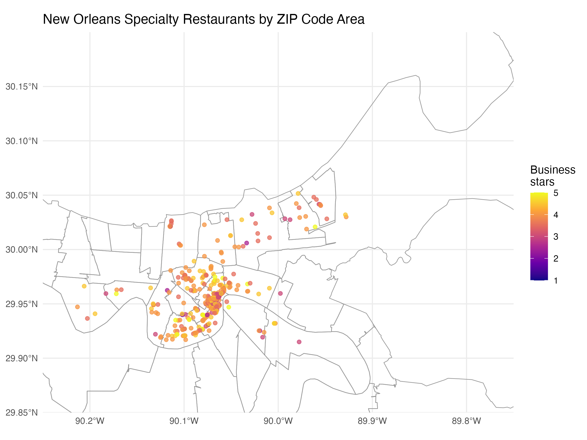
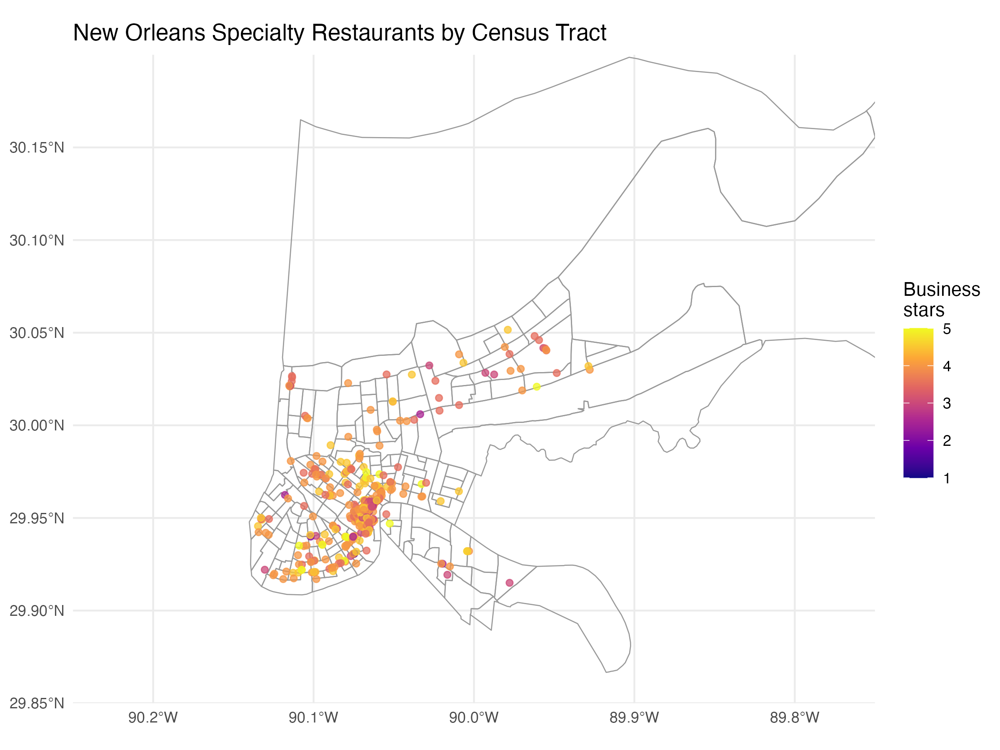
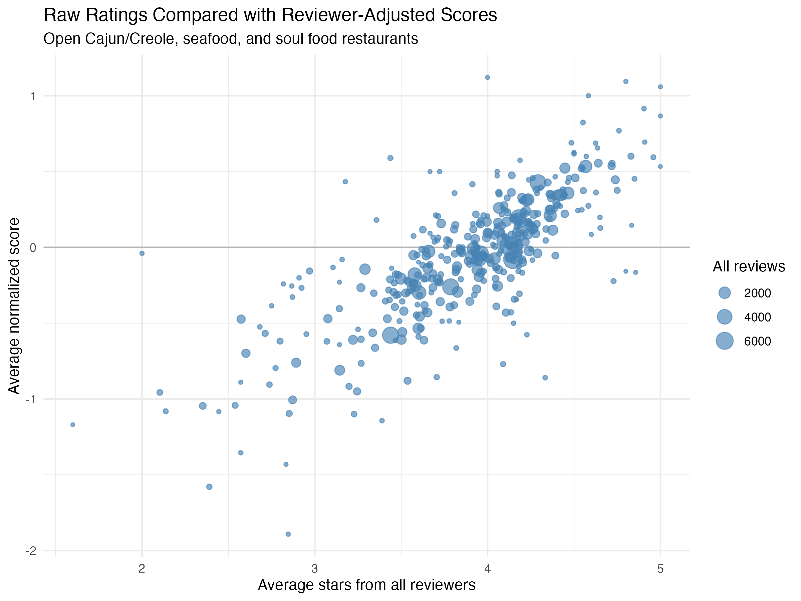
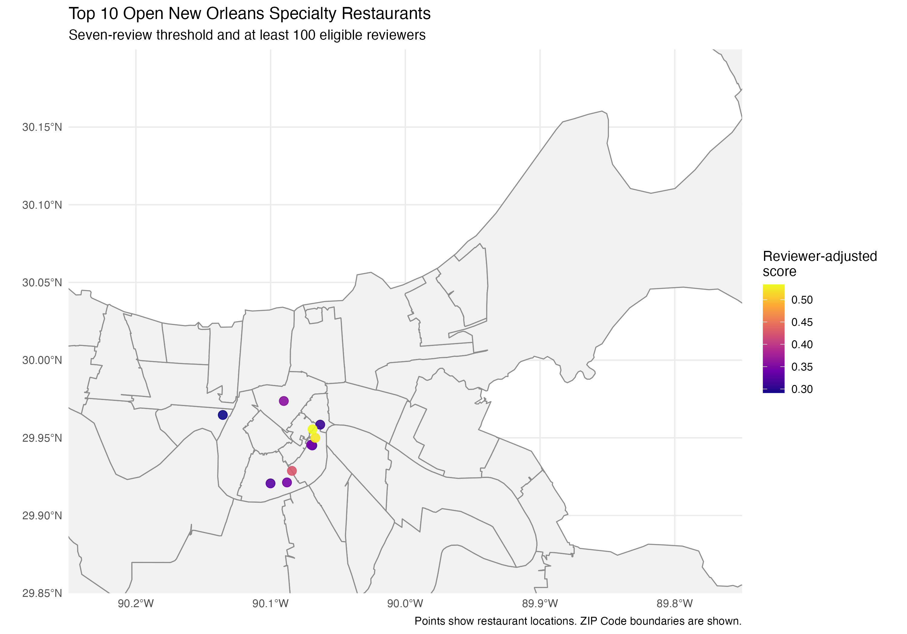

# Yelp New Orleans Restaurant Analysis

A portfolio project analyzing open Cajun/Creole, seafood, and soul food restaurants in New Orleans using Yelp ratings, reviews, reviewer-adjusted scores, ZIP Code areas, and Census tracts.

## Research question

Which open Cajun/Creole, seafood, and soul food restaurants—specialty foods New Orleans is known for—have the highest Yelp ratings, and which ZIP Code area is best for finding them?

## Executive summary

This project analyzes Yelp businesses in New Orleans that are categorized as Cajun/Creole, seafood, or soul food. These categories were selected because they represent important food traditions associated with New Orleans.

After removing businesses marked as closed, 400 open restaurants remained. ZIP Code 70113 had the highest average rating among ZIP Code areas containing at least 10 selected restaurants. The final restaurant rankings compare ordinary Yelp ratings with reviewer-adjusted scores that account for each reviewer’s usual rating behavior.

## Project files and folders

``` text
yelp-new-orleans-project/
├── README.md
├── yelp-new-orleans-project.Rproj
├── 01_import_and_filter_data.R
├── 03_category_analysis.R
├── 04_reviews_join.R
├── 05_spatial_analysis.R
├── 06_geographic_comparison.R
├── 07_reviewer_adjusted_ratings.R
├── data/
│   ├── raw/
│   └── new_orleans/
├── figures/
└── .gitignore
```

## Downloading the Yelp data

The data came from the [Yelp Open Dataset](https://business.yelp.com/data/resources/open-dataset/).

The downloaded archive contained several large JSON files:

- `yelp_academic_dataset_business.json`
- `yelp_academic_dataset_review.json`
- `yelp_academic_dataset_user.json`
- `yelp_academic_dataset_checkin.json`
- `yelp_academic_dataset_tip.json`

The business and review files were used for the main analysis. The raw files were extracted into the `data/raw/` folder.

The raw JSON files are not committed to GitHub because they are very large. The project instead saves smaller filtered datasets as RDS files.

## Large-data management

The Yelp data is too large to treat like a normal small CSV file. The business data was imported into R, filtered to New Orleans restaurants, and saved as an RDS file.

The large review file was processed using a memory-conscious approach. Reviews were filtered so that only reviews belonging to New Orleans restaurants were retained.

The main workflow was:

1.  Download the Yelp Open Dataset.
2.  Extract the JSON files.
3.  Store the raw files in `data/raw/`.
4.  Import and filter the business data.
5.  Save the New Orleans restaurant data as an RDS file.
6.  Import the review data.
7.  Keep only reviews belonging to New Orleans restaurants.
8.  Save the filtered reviews as an RDS file.
9.  Filter the data to open restaurants in the selected categories.

The raw JSON files can be deleted locally after the RDS files have been created if additional disk space is needed.

## Open-restaurant filter

The original category selection included both open and closed businesses. To make the final analysis more useful for someone looking for a restaurant, the updated analysis kept only businesses where:

``` r
is_open == 1
```

The open-business filter left 400 selected restaurants.

Closed restaurants were removed from:

- the category analysis;
- the review analysis;
- the geographic comparison;
- the ZIP Code analysis;
- the maps;
- the final top-10 rankings.

## Selected restaurant categories

The selected categories were:

- Cajun/Creole
- Seafood
- Soul Food

A restaurant was included if it belonged to at least one of these categories.

These categories were selected because New Orleans is strongly associated with Cajun and Creole cooking, seafood dishes, and soul food traditions. The project focuses on foods connected to New Orleans rather than comparing every type of restaurant in the Yelp dataset.

## Category cleaning and co-occurrence analysis

The Yelp `categories` field contains comma-separated category values. The project:

1.  Separated the categories into individual rows.
2.  Removed extra whitespace.
3.  Standardized capitalization.
4.  Counted individual categories.
5.  Identified category pairs that appeared within the same business.

The inclusion rule was:

> Include an open restaurant if it belongs to at least one of the following categories: Cajun/Creole, seafood, or soul food.

The category results are saved in:

- [`category_counts.csv`](data/new_orleans/category_counts.csv)
- [`selected_category_pairs.csv`](data/new_orleans/selected_category_pairs.csv)

The category analysis code is in [`03_category_analysis.R`](03_category_analysis.R).

## Geographic question

The geographic question was:

> Which geographic definition provides the most useful way to compare open New Orleans specialty restaurants?

Two geographic systems were compared:

- ZIP Code Tabulation Areas, or ZCTAs;
- Census tracts.

## Selected geographic region

I selected **ZIP Code 70113** as the main geographic region because it had the highest average Yelp business rating among ZIP Code areas containing at least 10 open restaurants from the selected category group.

ZIP Code 70113 contained:

- 13 open Cajun/Creole, seafood, or soul food restaurants;
- an average business rating of 4.23 stars.

I required each ZIP Code area to contain at least 10 restaurants so that the results would not be dominated by areas containing only one or two businesses.

## Top ZIP Code areas by average rating

| ZIP Code | Open restaurants | Average business rating |
|----------|-----------------:|------------------------:|
| 70113    |               13 |                    4.23 |
| 70117    |               16 |                    4.06 |
| 70115    |               39 |                    4.00 |
| 70122    |               10 |                    4.00 |
| 70119    |               39 |                    3.97 |
| 70116    |               45 |                    3.90 |
| 70118    |               14 |                    3.86 |
| 70130    |              120 |                    3.75 |
| 70112    |               41 |                    3.74 |
| 70124    |               11 |                    3.73 |

ZIP Code 70113 ranked first among ZIP Code areas containing at least 10 open selected restaurants.

## Maps of ZIP Code 70113





## Step 6: Geographic comparison

### Geographic comparison table

| Geographic system | Number of areas | Restaurants assigned | Unmatched restaurants | Smallest area count | Largest area count |
|------------|-----------:|-----------:|-----------:|-----------:|-----------:|
| ZIP/ZCTA | 20 | 400 | 0 | 1 | 120 |
| Census tract | 101 | 390 | 10 | 1 | 67 |

### Why ZIP Code areas were selected

ZIP Code Tabulation Areas were selected as the main geographic system for several reasons.

First, all 400 open selected restaurants were assigned to a ZIP Code area. Census tracts left 10 restaurants unmatched.

Second, ZIP Code areas are easier for a general audience to understand. People commonly recognize ZIP Codes when searching for restaurants or deciding where to eat.

Third, ZIP Code areas produced fewer geographic units than Census tracts. The ZIP Code analysis used 20 areas, while the Census tract analysis used 101 areas. The Census tract map provided more detail but was more difficult to interpret.

Finally, ZIP Code areas provided enough restaurants for meaningful comparisons. ZIP Code 70113 had 13 open restaurants and ranked first among areas with at least 10 restaurants.

Census tracts were useful for comparison, but their smaller boundaries created more areas with very few restaurants and a more complicated map. For this project, ZIP Code areas better matched the practical question of where someone might look for New Orleans specialty restaurants.

### ZIP Code map



### Census tract map



The geographic comparison code is in [`06_geographic_comparison.R`](06_geographic_comparison.R).

## Step 7: Ratings using all reviewers

The first rating analysis used all available Yelp reviews for the 400 open selected restaurants.

For each restaurant, the analysis calculated:

- the total number of reviews;
- the average Yelp review rating;
- the median Yelp review rating.

The results are saved in:

- [`all_reviewer_summary.csv`](data/new_orleans/all_reviewer_summary.csv)
- [`restaurant_summary_raw_adjusted.csv`](data/new_orleans/restaurant_summary_raw_adjusted.csv)

## Reviewer-activity threshold

Reviewers with only one or two reviews provide limited evidence about their general rating behavior. The primary analysis therefore defined an eligible reviewer as someone who had written at least seven reviews within the selected category group.

A five-review threshold was also tested as a sensitivity analysis.

The seven-review threshold was used for the primary reviewer-adjustment analysis.

## Reviewer-adjusted scores

Some reviewers regularly give restaurants high ratings, while others are more critical. To account for this difference, the analysis calculated each reviewer’s average rating within the selected category group.

The reviewer-adjusted score was calculated as:

``` text
individual restaurant rating - reviewer’s usual average rating
```

For example:

- A reviewer with an average rating of 5 gives a restaurant 5 stars: normalized score = 0.
- A reviewer with an average rating of 5 gives a restaurant 4 stars: normalized score = -1.
- A reviewer with an average rating of 3 gives a restaurant 4 stars: normalized score = +1.

The normalized score is not a new Yelp rating. It measures whether the reviewer rated a restaurant higher or lower than their usual rating behavior.

The mean-based normalized score was used as the primary adjusted measure because it uses all of a reviewer’s ratings and provides a straightforward comparison with the reviewer’s usual average.

## Final reliability requirement

The final restaurant ranking required at least **100 different eligible reviewers per restaurant**.

This requirement reduces the influence of restaurants with very small reviewer samples. After applying this requirement, 62 restaurants remained available for comparison.

The final ranking therefore used:

- open restaurants only;
- Cajun/Creole, seafood, or soul food categories;
- reviewers with at least seven reviews;
- at least 100 different eligible reviewers per restaurant;
- average reviewer-normalized scores.

## Raw ratings compared with reviewer-adjusted scores

The graph compares ordinary Yelp ratings with reviewer-adjusted scores.

Larger circles represent restaurants with more total reviews. Points above zero indicate that reviewers rated a restaurant higher than their usual rating behavior. Points below zero indicate that reviewers rated a restaurant lower than their usual rating behavior.



## Final top-10 restaurants

The top 10 restaurants were:

|business_name           |city        |postal_code | number_of_eligible_reviewers| number_of_eligible_reviews| average_stars_eligible_reviewers| average_normalized_score|
|:-----------------------|:-----------|:-----------|----------------------------:|--------------------------:|--------------------------------:|------------------------:|
|GW Fins                 |New Orleans |70112       |                          246|                        269|                             4.52|                     0.53|
|Restaurant August       |New Orleans |70130       |                          182|                        193|                             4.49|                     0.52|
|Commander's Palace      |New Orleans |70130       |                          522|                        572|                             4.42|                     0.43|
|Parkway Bakery & Tavern |New Orleans |70119       |                          357|                        397|                             4.33|                     0.36|
|Atchafalaya Restaurant  |New Orleans |70115       |                          276|                        297|                             4.35|                     0.35|
|Carmo                   |New Orleans |70130       |                          112|                        126|                             4.37|                     0.35|
|La Petite Grocery       |New Orleans |70115       |                          134|                        143|                             4.28|                     0.33|
|Pêche                   |New Orleans |70130       |                          250|                        264|                             4.25|                     0.32|
|Muriel's Jackson Square |New Orleans |70116       |                          203|                        231|                             4.28|                     0.31|
|Crabby Jack's           |New Orleans |70121       |                          100|                        109|                             4.23|                     0.29|

The final top-10 results are saved in:

[`final_top_10_restaurants.csv`](data/new_orleans/final_top_10_restaurants.csv)

The final top-10 list is based on the average reviewer-normalized score after requiring at least 100 different eligible reviewers.

## Final top-10 restaurant map

This map shows the locations of the final top-10 open restaurants. The points are colored by their average reviewer-adjusted score, and ZIP Code boundaries provide geographic context.



## Main findings

- ZIP Code 70113 was the highest-rated ZIP Code area among areas containing at least 10 open selected restaurants.
- ZIP Code 70113 contained 13 open specialty restaurants and had an average business rating of 4.23 stars.
- ZIP Code areas were easier to interpret and had fewer unmatched restaurants than Census tracts.
- Reviewer-adjusted rankings account for whether reviewers are generally generous or critical.
- Requiring at least 100 different eligible reviewers produced a more reliable comparison than ranking restaurants with only a few eligible reviewers.
- Closed restaurants were removed from the final analysis.

## Conclusion

ZIP Code 70113 was the strongest geographic area in this analysis because it had the highest average business rating among ZIP Code areas containing at least 10 open Cajun/Creole, seafood, or soul food restaurants.

ZIP Code Tabulation Areas were selected as the main geographic system because they were easier to understand, assigned all 400 open restaurants, and produced clearer maps than Census tracts.

The reviewer-adjusted analysis also shows why reviewer behavior matters. Ordinary Yelp averages and reviewer-adjusted scores do not always produce the same ranking. Requiring at least 100 different eligible reviewers makes the final comparison less dependent on restaurants with very small samples.

## AI prompts and reprompting examples

AI assistance was used to help organize the workflow, explain R errors, and improve the clarity of the analysis. The results were checked in R.

### Example 1: Filtering closed restaurants

Initial prompt:

> The top restaurant is closed on Yelp. How do I refilter the dataset to include only restaurants that are open?

Follow-up prompt:

> Update Steps 3 through 7 so that closed restaurants are removed consistently.

This led to adding:

``` r
filter(is_open == 1)
```

throughout the analysis.

### Example 2: Choosing a reviewer threshold

Initial prompt:

> Five reviews was used as the reviewer threshold. Would a higher threshold be better?

Follow-up prompts:

> Compare thresholds of 5, 6, 7, 8, and 10 reviews.

> Compare the top-10 rankings using thresholds of 5 and 7.

The final analysis used seven reviews as the minimum activity level for reviewers.

### Example 3: Improving the map

Initial prompt:

> The restaurant names are covering the points on the map. Can you remove the names?

Follow-up prompt:

> Keep the ZIP Code boundaries and colored restaurant points, but do not display restaurant labels.

This produced a clearer map without overlapping labels.

### Example 4: Improving ranking reliability

Initial prompt:

> Should we put more emphasis on the number of eligible reviewers?

Follow-up prompt:

> Check how many restaurants have at least 50 and at least 100 different eligible reviewers.

The final analysis used at least 100 different eligible reviewers. This left 62 restaurants available for comparison.

### Example 5: Fixing the spatial join

Initial error:

``` text
st_crs(x) == st_crs(y) is not TRUE
```

Follow-up prompt:

> Update the code so that the boundary data and restaurant points use the same CRS before the spatial join.

The solution was:

``` r
st_transform(st_crs(restaurant_points))
```

## Reproducing the project

1.  Clone or download this repository.
2.  Download the Yelp Open Dataset.
3.  Extract the JSON files into `data/raw/`.
4.  Open the `.Rproj` file in RStudio.
5.  Run `01_import_and_filter_data.R`.
6.  Run `03_category_analysis.R`.
7.  Run `04_reviews_join.R`.
8.  Run `05_spatial_analysis.R`.
9.  Run `06_geographic_comparison.R`.
10. Run `07_reviewer_adjusted_ratings.R`.

The raw Yelp JSON files are not included in the repository because of their size. The filtered RDS and CSV files contain the smaller datasets and analysis outputs used by the project.

## Source code

- [Steps 1–2: Import and filter the data](01_import_and_filter_data.R)
- [Step 3: Category analysis](03_category_analysis.R)
- [Step 4: Join businesses to reviews](04_reviews_join.R)
- [Step 5: Spatial analysis](05_spatial_analysis.R)
- [Step 6: Geographic comparison](06_geographic_comparison.R)
- [Step 7: Reviewer-adjusted ratings](07_reviewer_adjusted_ratings.R)

## Sources

- [Yelp Open Dataset](https://business.yelp.com/data/resources/open-dataset/)
- [U.S. Census TIGER/Line Files](https://www.census.gov/geographies/mapping-files/time-series/geo/tiger-line-file.html)
- [tigris package documentation](https://walker-data.com/tigris/)
- [Quarto GitHub Pages documentation](https://quarto.org/docs/publishing/github-pages.html)
