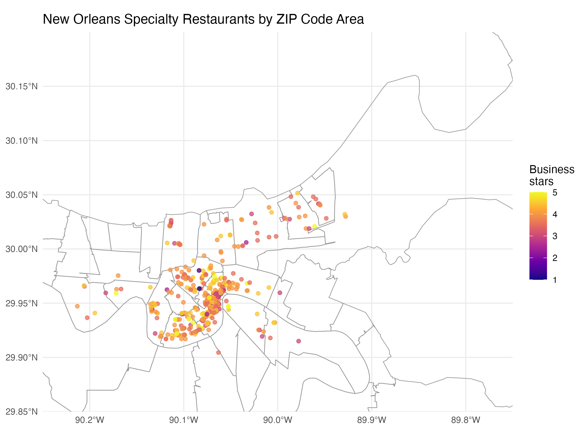
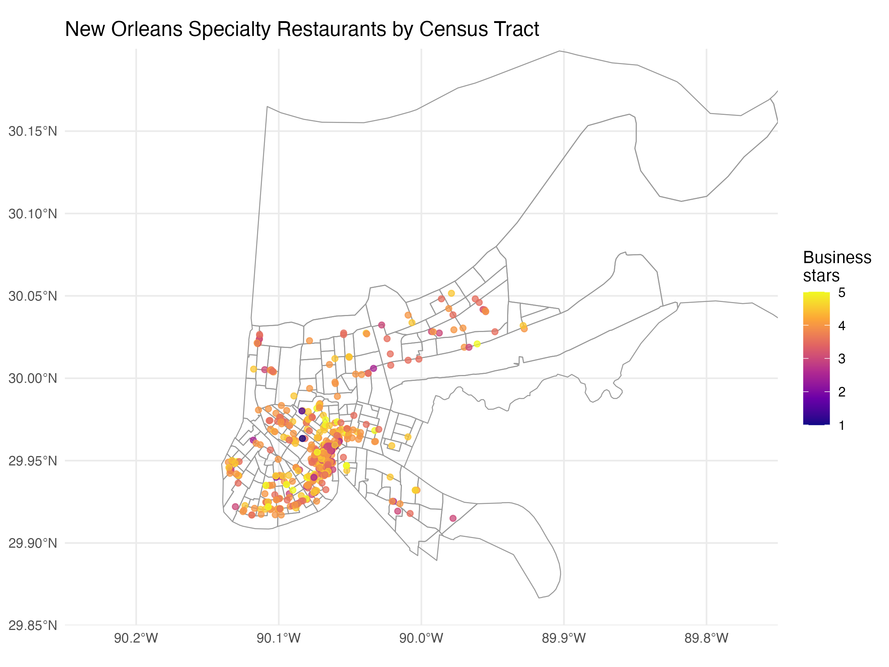

# yelp-new-orleans-project

## Step 6: Geographic comparison

### Selected geographic system

I selected ZIP Code Tabulation Areas (ZCTAs) as the main geographic system and compared them with Census tracts.

I selected ZCTAs because all 607 selected restaurants were assigned to a ZCTA, while 13 restaurants were unmatched using Census tracts. ZCTAs also produced fewer and larger areas, making them easier to understand and visualize. Census tracts provided more detail, but their smaller boundaries created a more complicated map and included areas with very few restaurants.

### Geographic comparison table

| Geographic system | Number of areas | Restaurants assigned | Unmatched restaurants | Smallest area count | Largest area count |
|---|---:|---:|---:|---:|---:|
| ZIP/ZCTA | 22 | 607 | 0 | 1 | 194 |
| Census tract | 108 | 594 | 13 | 1 | 102 |

### ZIP Code map

### Census tract map

